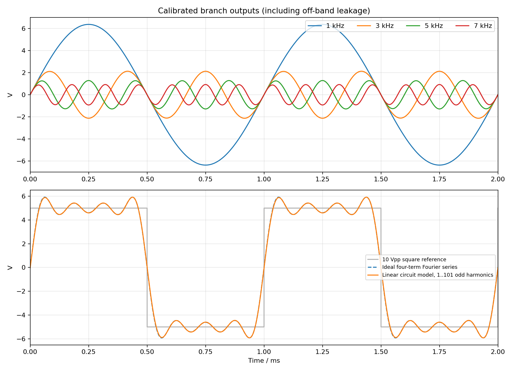

# 波形合成电路 / Waveform Synthesis Circuit

NE555 + TL082，外接 ±12 V。NE555 产生约 2 kHz 时钟，经 CD4013 二分频、隔直和缓冲后得到可校准的 1 kHz、10 Vpp 方波。四路分别提取 1/3/5/7 kHz，调幅、移相后相加。

**Rev A 是已通过本地检查、需要实物校准的设计版本；尚未在嘉立创 EDA 专业版中实际导入验证。** 提供自包含 KiCad 可编辑源文件及 EAGLE XML 交换文件，不冒充嘉立创原生 `.epro` 工程。

| 文件 | 用途 |
|---|---|
| [导入说明](docs/IMPORT_EASYEDA_PRO.md) | 两种交换包、导入后核对项目、版本限制 |
| [设计及校准说明](docs/DESIGN.md) | 电路公式、元件参数、接口、22 个电位器的调试步骤 |
| [验证记录](docs/VALIDATION.md) | 已完成、自动通过、待验证及已知限制 |
| [原理图 PDF](docs/schematic.pdf) | 总览 + 6 个功能页；使用同名全局网络连接 |
| [PCB 预览](docs/pcb.svg) | 双层，229 × 231 mm，全部插件安装 |
| [BOM](hardware/BOM.csv) / [分组 BOM](hardware/BOM_grouped.csv) | 逐项和采购分组；无未经核对的立创商品编号 |
| [KiCad 工程](hardware/waveform.kicad_pro) | KiCad 9.0.2；打开同目录的主原理图和 PCB |
| [EAGLE 原理图](hardware/waveform.sch) / [PCB](hardware/waveform.brd) | XML 交换格式，元件库内嵌 |
| [release](release/) | 两种导入 ZIP、制板输出 ZIP、校验和 |

自动检查：ERC、DRC、未连接项、原理图/PCB 一致性均为 0 项；190 个封装、491 个引脚核对一致。EAGLE PCB 经 KiCad 的实际 EAGLE 导入器回读，489 个已连接引脚保持一致；2 个 CD4013 备用输出明确不连接。详细证据见 `validation/`。

波形计算采用 TL082 单极点近似，而非厂家 SPICE 模型或实测。四项傅里叶合成有 Gibbs 过冲，源方波 10 Vpp 对应的合成输出约 11.84 Vpp；如需要合成输出也恰为 10 Vpp，可统一缩放四路幅度，但不能消除有限谐波的过冲。

复现环境：系统 Python 3 + `pcbnew`、KiCad CLI 9、g++；分析脚本使用 Python 的 numpy/scipy/matplotlib。运行 `tools/validate.sh` 检查已有设计。**`tools/rebuild.sh` 会重新生成并覆盖本项目的生成文件，仅在确认没有手工编辑后使用。** 现有云任务已经隔离，无需另建 Git worktree。
